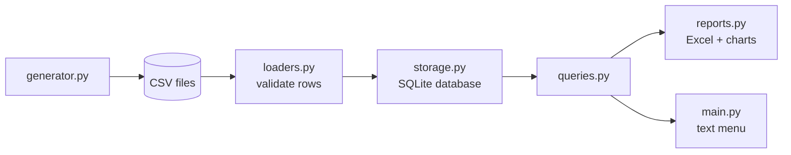

## due-diligence: Component & Asset Management System ⌛

[due-diligence](https://github.com/alissamaharaj/due-diligence/blob/main/src/main.py) is a maintenance-tracking system for industrial equipment, built to model how service schedules are stored, validated, and reported on: multiple procedures per asset at different intervals, a database as the single source of truth, and clear answers to "what is due, and what is overdue?" Built as Python Project 2 of my self-study track in control systems and industrial data engineering, using plain Python and SQLite, and learning most of the tools (SQL joins, `unittest`, `xlsxwriter`) as the project needed them.

Detailed process notes can be found in [notes.md](https://github.com/alissamaharaj/due-diligence/blob/main/notes.md).

---

### What it Does

The system tracks six types of industrial assets (motors, pumps, generators, transformers, HVAC units, and boilers). Each asset has four service procedures at weekly, monthly, quarterly, and annual intervals, and every completed service is recorded in a history table. Pumps and motors are linked in pairs.

A generator produces a fixed-seed dataset (40 assets, 160 procedures, 543 service records), which is validated by the loaders and stored in a SQLite database. From there, the system can report which procedures are due next, due within a chosen window, or overdue, and can break overdue procedures down by location and asset type. Three Excel workbooks with native charts are written to `reports/`:

- **overdue_by_location.xlsx**: overdue procedures per location (with service history vs. never serviced), stacked column chart
- **overdue_by_type.xlsx**: the same breakdown per asset type, stacked column chart
- **history_by_month.xlsx**: services completed per month, line chart

Everything is run from a simple text menu.

### Design Rationale

In actual industrial maintenance, there is not one service date per machine; maintenance constitutes several procedures on different schedules, so each asset type gets its own set of four procedures rather than a single interval. The design choices follow from there:

- **Due dates are calculated, not stored.** The next due date is the last completed service plus the interval, or the commissioning date plus the interval if the procedure has never been serviced. This way, never-serviced procedures are not hidden, and every procedure always has a due date.
- **Bad data is rejected with a reason.** Each loader checks every row (blank fields, invalid dates, duplicates, missing parent records, mismatched links, and so on) and records exactly one failure reason per rejected row. The database schema (`NOT NULL`, `CHECK`, foreign keys) is a second line of defense behind the loaders.
- **"Due today" is not overdue.** Overdue is strictly `next_due < today`, and the due-within window is inclusive at both ends.
- **Answer keys come from independent sources.** Query output was verified against spreadsheet pivot tables built from the same data, not against the query's own results.

### Pipeline



### Menu Options

| Option | Action |
| :--- | :--- |
| 1 | Generate data |
| 2 | Load database |
| 3 | Write reports |
| 4 | Due next (asks how many procedures) |
| 5 | Due within (asks for a start date and number of days) |
| 6 | Overdue (prints the count and each procedure) |
| 7 | Overdue by location |
| 8 | Overdue by asset type |
| 0 | Quit |

### How it Works

- Source data lives in four tables (`Assets`, `Procedures`, `Frequencies`, `Service_History`). Service frequency is stored as text, and a small lookup table converts it to an interval in days.
- Loaders read each CSV, check every row, and return a list of good rows and a list of rejected rows with row numbers and reasons. `load_all()` chains them together because each loader depends on the output of the previous one.
- The core query joins procedures to their last completed date and calculates the next due date. `LEFT JOIN` keeps procedures with no history, and `COALESCE` falls back to the commissioning date.
- Every other date-based query (`due_next`, `due_within`, `overdue_procedures`, `overdue_by_location`, `overdue_by_type`) repeats the same due-date expression.
- Reports use `xlsxwriter`, with `SUM` formulas built from the row count so totals stay correct if the data changes.

### Core Skills Demonstrated

- SQL: joins, `LEFT JOIN`, subqueries, aggregates, `COALESCE`, date arithmetic
- Data validation and error reporting
- Relational schema design with constraints and foreign keys
- Unit testing with `unittest`
- Excel report automation with `xlsxwriter` (formulas, native charts)
- Seeded test-data generation
- File and path handling
- Menu-driven command-line interface

### Sample Output

Option 4 (Due next) and option 7 (Overdue by Location), run on 2026-11-10:

```
Due next...
How many procedures? 5
Procedure ID: GEN-001-P1, Last Done: never serviced, Next Due: 2023-01-14
Procedure ID: GEN-002-P3, Last Done: never serviced, Next Due: 2023-03-11
Procedure ID: PMP-008-P3, Last Done: never serviced, Next Due: 2023-06-17
Procedure ID: PMP-001-P1, Last Done: never serviced, Next Due: 2023-06-29
Procedure ID: BLR-001-P3, Last Done: never serviced, Next Due: 2023-07-03
```

```
Overdue by Location...
Location: Substation, With History: 4, Never Serviced: 14
Location: Boiler Room, With History: 6, Never Serviced: 9
Location: Pump Room 1, With History: 4, Never Serviced: 11
Location: Generator Room, With History: 4, Never Serviced: 9
Location: Rooftop, With History: 4, Never Serviced: 6
Location: Pump Room 2, With History: 1, Never Serviced: 7
```

### Relevance

Scheduled maintenance is the backbone of industrial reliability, and sites track it in computerized maintenance management systems (CMMS). This project models the core of one: assets, recurring procedures, completed work, and the question those systems exist to answer, which is what is overdue and where.

For data analytics, it covers the full path from raw records to a finished report: validating incoming data and rejecting bad rows with documented reasons, storing it in a relational schema, answering questions with SQL, and presenting the results in Excel with charts. Verifying output against independently built pivot tables reflects the same habit of checking numbers that analytics work depends on.

For maintenance planning, the overdue, due-next, and due-within views are the basic planning tools: what is behind schedule, what is coming up, and which locations and asset types carry the backlog. Separating overdue procedures with service history from those never serviced shows the difference between a lapsed schedule and a gap in the records.

For predictive control and predictive maintenance, the service history table is the kind of time-stamped record that condition-based and predictive approaches build on. This project does not do any prediction. It builds the clean, validated data foundation that such work needs, and a pandas-based analysis stage is a natural next step.

### How to run

Requires Python 3 and one external package (`xlsxwriter`):

```
pip install -r requirements.txt
python src/main.py
```

Run the menu options in order the first time: **1** (generate data), **2** (load database), **3** (write reports). Options 4 to 8 then query the database.

**Notes on the data:**
- The generator uses a fixed seed (42), so the same dataset is produced every time, but it uses the live date, so the dates shift and results change from day to day.
- The `reports/` folder in this repo contains the workbooks verified on 2026-11-02. Running option 3 overwrites them with versions built on the current date.
- The loaders are tested against small hand-made CSVs in `data/` that include deliberately bad rows, using `tests/test_loaders.py`. The generator itself produces clean rows only.
